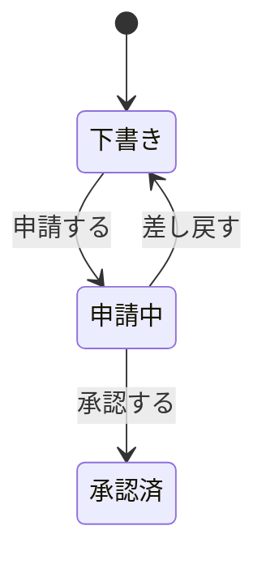

# {{title}}

## このアグリゲートは何か

一言で。**1 ファイルに 1 アグリゲート**（不変条件は複数エンティティに跨るため、
エンティティ単位に割ると書く場所が無くなる）。

## 不変条件

このアグリゲートの中で**常に成り立つこと**。**無いなら「無い」と書く**。

-

## エンティティ

このアグリゲートにまとめるエンティティ。**どれがルートか**を必ず埋める。

| 論理名 | 物理名 | ルート | 備考 |
| --- | --- | --- | --- |
|  |  |  |  |

## 属性

**エンティティの数だけ、この `###` の節を複製する。**

キーは `PK` / `FK → 顧客.顧客ID` のように書く（**FK は参照先まで**）。

### <エンティティの論理名>

| 論理名 | 物理名 | 型 | 必須 | キー | 備考 |
| --- | --- | --- | --- | --- | --- |
|  |  |  |  |  |  |

## インデックス

対象カラムが複数なら**順序どおりに**並べる（索引は順序が効く）。

| 名前 | 対象エンティティ | 対象カラム | 備考 |
| --- | --- | --- | --- |
|  |  |  |  |

## 複合ユニーク

**インデックスとは別の節にしてある。**一意性は業務ルールで、
性能のための索引とは決める理由が違う。

| 名前 | 対象エンティティ | 対象カラム | 備考 |
| --- | --- | --- | --- |
|  |  |  |  |

## 状態

物理名は `DRAFT` のような大文字スネークで揃える。

| エンティティ | 論理名 | 物理名 | 備考 |
| --- | --- | --- | --- |
|  |  |  |  |

## イベント

アクターは**誰がそのイベントを起こすか**（`ログイン済みユーザー` `システム（起動時）` など）。
複数あれば `、` で並べる。

| エンティティ | 論理名 | 物理名 | アクター | 備考 |
| --- | --- | --- | --- | --- |
|  |  |  |  |  |

## 状態遷移図

上の 2 つの表を図にする。**遷移は状態とイベントの組**なので、どちらの表にも書けない。
下は書き換えるための例。

## 未決

決まっていないことを書く。**無いなら「無い」と書く**（空欄は書き忘れと区別できない）。

-
