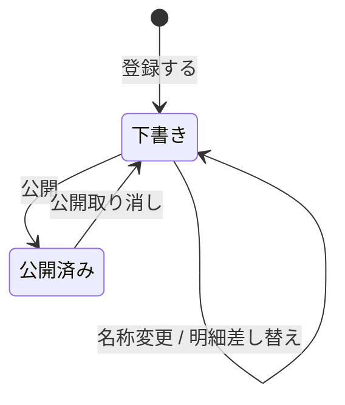

# Sample アグリゲート

## このアグリゲートは何か

名称と明細（`SampleItem`）を持ち、下書き / 公開済みの状態を行き来する参照実装用のアグリゲート。
ルートは `Sample` で、明細の一貫性（ラベルの重複禁止・表示順の連番）と状態遷移の可否を
`Sample` が守る。分類（[002_category](../カテゴリ/002_category.md)）は別アグリゲートなので、
ID だけを持つ。

実装: `backend/app/domain/sample/entity.py`、`backend/app/infrastructure/sample/model.py`

## 不変条件

- **名称は全体で一意**。大文字小文字は区別する（`SampleService._ensure_unique_name` が先に弾き、
  `uq_samples_name` が最後の砦）。
- **同じ Sample の中で明細のラベルは重複しない**（`uq_sample_items_sample_id_label`）。
- **明細の表示順は 0 起点の連番で、明細の並び順と一致する。**
  `Sample.replace_items()` が渡された並び順で必ず振り直すので、呼び出し側は指定しない。
- **明細は Sample が無いと存在しない。**親の削除で連鎖削除される（`ON DELETE CASCADE`）。
- **カテゴリ ID は必須**で、常に実在する Category を指す。指す先が無いのはデータ不整合として扱う
  （`CategoryService.get_many()` が `EntityNotFoundError`）。
- **`draft` のときだけ名称変更と明細差し替えができる。**`published` では
  `Sample._ensure_draft()` が `InvalidStateError` を投げる。
- **別アグリゲートである Category はエンティティとして保持しない**（持つのは `category_id` だけ）。

## エンティティ

| 論理名 | 物理名 | ルート | 備考 |
| --- | --- | --- | --- |
| サンプル | `samples` | ○ | ルート。`Sample` |
| サンプル明細 | `sample_items` |  | `SampleItem`。単体では存在せず、必ず親経由で読み書きする |

## 属性

### サンプル

| 論理名 | 物理名 | 型 | 必須 | キー | 備考 |
| --- | --- | --- | --- | --- | --- |
| ID | `id` | UUID | ○ | PK | ドメイン側で採番する（`uuid4`）。DB の採番に依存しない |
| 名称 | `name` | 文字列(100) | ○ |  | 1〜100 文字。全体で重複しない |
| カテゴリID | `category_id` | UUID | ○ | 参照 → カテゴリ.ID | **別アグリゲートのため DB の外部キーは張らない。**既定値は「未分類」の固定 ID |
| ステータス | `status` | 文字列(20) | ○ |  | `SampleStatus` の値。既定は `draft`。PostgreSQL の enum 型は使わない |

明細は列ではなくアグリゲート内の子エンティティとして持つ（`Sample.items`）。

### サンプル明細

| 論理名 | 物理名 | 型 | 必須 | キー | 備考 |
| --- | --- | --- | --- | --- | --- |
| ID | `id` | UUID | ○ | PK | ドメイン側で採番する（`uuid4`） |
| サンプルID | `sample_id` | UUID | ○ | FK → サンプル.ID | 同一アグリゲート内なので外部キーを張る。`ON DELETE CASCADE` |
| ラベル | `label` | 文字列(100) | ○ |  | 1〜100 文字。同じサンプルの中で重複しない |
| 表示順 | `sort_order` | 整数 | ○ |  | 0 起点。`Sample.replace_items()` が並び順で振り直す |

## インデックス

| 名前 | 対象エンティティ | 対象カラム | 備考 |
| --- | --- | --- | --- |
| `ix_samples_category_id` | サンプル | `category_id` | カテゴリ名での絞り込み（`category_id IN (...)`）のため |

親から子を引く索引は別に張っていない。下の `uq_sample_items_sample_id_label` が張る複合索引の
**先頭列が `sample_id`** なので、そちらで足りる（単独の索引は冗長になるため張らない）。

## 複合ユニーク

| 名前 | 対象エンティティ | 対象カラム | 備考 |
| --- | --- | --- | --- |
| `uq_samples_name` | サンプル | `name` | 単一カラム。全体で名称が重複しないという業務ルール |
| `uq_sample_items_sample_id_label` | サンプル明細 | `sample_id`, `label` | アグリゲート内の一意性。順序どおり（先頭が `sample_id`）なので索引としても効く |

## 状態

| エンティティ | 論理名 | 物理名 | 備考 |
| --- | --- | --- | --- |
| サンプル | 下書き | `DRAFT` | 値は `draft`。登録直後の状態 |
| サンプル | 公開済み | `PUBLISHED` | 値は `published` |

サンプル明細は状態を持たない。

## イベント

| エンティティ | 論理名 | 物理名 | アクター | 備考 |
| --- | --- | --- | --- | --- |
| サンプル | 名称変更 | `rename` | ログイン済みユーザー | `draft` のときだけ。編集できるのは `name` |
| サンプル | 明細差し替え | `replace_items` | ログイン済みユーザー | `draft` のときだけ。編集できるのは `items`。表示順を振り直す |
| サンプル | 公開 | `publish` | ログイン済みユーザー | `draft` → `published`。編集するフィールドは無い |
| サンプル | 公開取り消し | `unpublish` | ログイン済みユーザー | `published` → `draft`。編集するフィールドは無い |

上の 4 つが `Sample.EDITABLE_FIELDS` と `available_events()` に載る（インターフェース層の
`action_schemas` はここから機械生成される）。**登録（`create`）はイベントに含めない** ──
まだ存在しないアグリゲートに対する操作で、`available_events()` が返す対象ではないため。

## 状態遷移図

## 未決

- **カテゴリを選び直す経路が無い。**登録時もカテゴリを指定できず、常に「未分類」になる。
  イベントとして `change_category` を足すのか、登録時の入力にするのかは決めていない。
- **削除が無い。**Sample を消す操作をアグリゲートに持たせるか（論理削除か物理削除か）は未決。
- **明細の部分更新が無い。**現状は `replace_items` による全差し替えのみ。1 件追加・1 件削除の
  イベントを足すかは決めていない。
