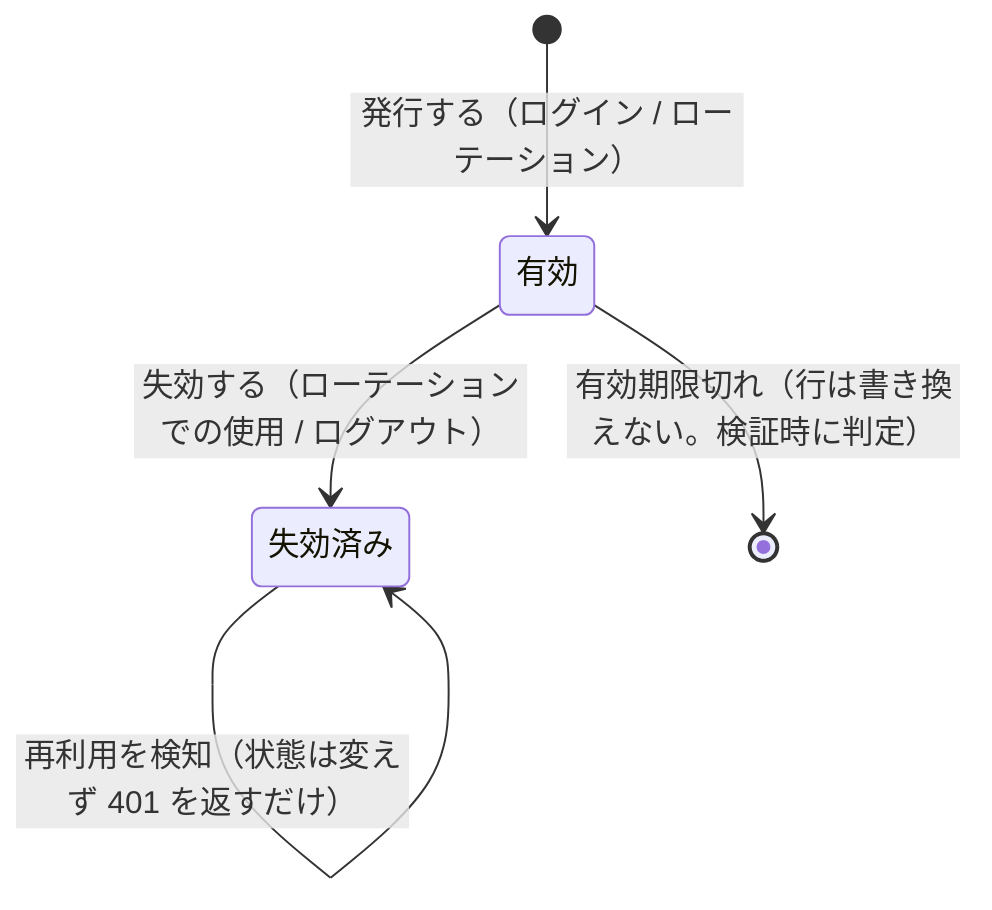

# RefreshToken アグリゲート

## このアグリゲートは何か

リフレッシュトークンの失効を管理する軽量な 1 テーブルのアグリゲート。ルートは `RefreshToken` の
みで、子エンティティは持たない。[017_user](017_user.md) のユーザーを ID だけで参照する
（別アグリゲートのため `User` エンティティ自体は持たない）。

アクセストークンはこのテーブルでは管理しない（JWT の署名検証のみで完結させ、失効の仕組みを
持たせない想定。完了条件の「期限切れ / 改ざんで 401」は署名・有効期限の検証だけで満たす）。

要望 00027 で実装済み（`app/domain/refresh_token/`、`app/infrastructure/refresh_token/`、
マイグレーション `20260914_9f9982a91989_add_auth.py`）。

## 不変条件

- **失効した（`revoked = true` の）行、または有効期限（`expires_at`）を過ぎた行は認証に使えない。**
  期限切れは行を書き換えず、検証時に `expires_at` と現在時刻を比較して判定する
  （期限切れ行の物理削除は「あると望ましい」止まりで、今回のスコープ外）。
- **失効した行は再び有効に戻らない**（`revoked` は false → true の一方向）。
- **ローテーションで使われた旧トークンは、新トークンの発行と同じ操作の中でその場で失効させる**
  （旧を失効させずに新だけ発行することはしない）。
- 1 ユーザーにつき複数の `RefreshToken` 行を同時に持てる（ログイン中の端末の数だけ行が増える）。
  **複数端末での同時ログインを許容する（②で確定。新規ログインは他端末のトークンを失効させない）。**

## エンティティ

| 論理名 | 物理名 | ルート | 備考 |
| --- | --- | --- | --- |
| リフレッシュトークン | `refresh_tokens` | ○ | ルート。子は持たない |

## 属性

### リフレッシュトークン

| 論理名 | 物理名 | 型 | 必須 | キー | 備考 |
| --- | --- | --- | --- | --- | --- |
| ID | `id` | UUID | ○ | PK | ドメイン側で採番する（`uuid4`）。**JWT の `jti` にそのまま使う。ハッシュ化しない**（③で確定。署名が無ければトークンとして成立しないため、ID だけ DB にあっても悪用できない） |
| ユーザーID | `user_id` | UUID | ○ | インデックス（`ix_refresh_tokens_user_id`）。参照 → ユーザー.ID | 別アグリゲートのため外部キーは張らない |
| 発行日時 | `issued_at` | 日時（timezone 付き） | ○ |  | 発行した時刻。UTC の aware datetime |
| 有効期限 | `expires_at` | 日時（timezone 付き） | ○ |  | この時刻を過ぎたら無効。既定の有効期間は **30 日（1 ヶ月）**、env（`REFRESH_TOKEN_EXPIRE_DAYS`）で変更可。③で確定 |
| 失効フラグ | `revoked` | 真偽値 | ○ |  | 既定 `false`。ローテーションでの失効とログアウトでの失効を**区別しない**（同じフラグ）。③で確定 |
| 失効日時 | `revoked_at` | 日時（timezone 付き） |  |  | `revoked = true` にした時刻。**失効理由（ローテーション/ログアウト/リプレイ検知）は保持しない**（③で確定） |

## インデックス

| 名前 | 対象エンティティ | 対象カラム | 備考 |
| --- | --- | --- | --- |
| `ix_refresh_tokens_user_id` | リフレッシュトークン | `user_id` | ログアウト時に「そのユーザーの有効なトークン」を引くため。リプレイ検知（今回は実装しない）を後から足すときにも使える想定で張ってある |

## 複合ユニーク

無い。

## 状態

| エンティティ | 論理名 | 物理名 | 備考 |
| --- | --- | --- | --- |
| リフレッシュトークン | 有効 | `ACTIVE` | 値は保持しない導出状態。`revoked = false` かつ `expires_at` が未到来 |
| リフレッシュトークン | 失効済み | `REVOKED` | `revoked = true`。ローテーションでの失効・ログアウトでの失効を区別しない |

「有効」は DB 上のカラムではなく `revoked` と `expires_at` から導出される状態である点に注意。

## イベント

| エンティティ | 論理名 | 物理名 | アクター | 備考 |
| --- | --- | --- | --- | --- |
| リフレッシュトークン | 発行 | `issue` | 未ログインのユーザー（ログイン時）、リフレッシュトークンを持つユーザー（ローテーション時） | ログイン成功時、またはローテーション成功時に新規発行（INSERT） |
| リフレッシュトークン | 失効 | `revoke` | リフレッシュトークンを持つユーザー（ローテーション時）、ログイン済みユーザー（ログアウト時） | ローテーションでの旧トークン失効、ログアウトでの失効で使う。リプレイ検知時の一括失効は今回実装しない |

## 状態遷移図

## 未決

- **期限切れ行を掃除する仕組み（物理削除）は「あると望ましい」止まりで未確定。**
  今回の実装方針にも含まれていない。

③で確定し、ここから外れたもの: `jti` の持ち方（`id` をそのまま使う）、失効理由を区別するか
（区別しない）、リプレイ検知（**今回は実装しない**。`ix_refresh_tokens_user_id` は将来のために
張ってあるが、MVP では使わない）。いずれも上の「属性」「不変条件」参照。
